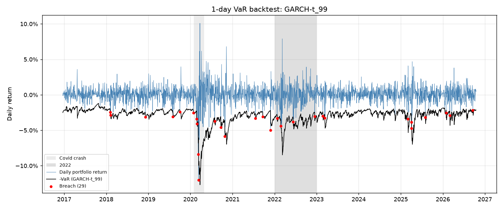
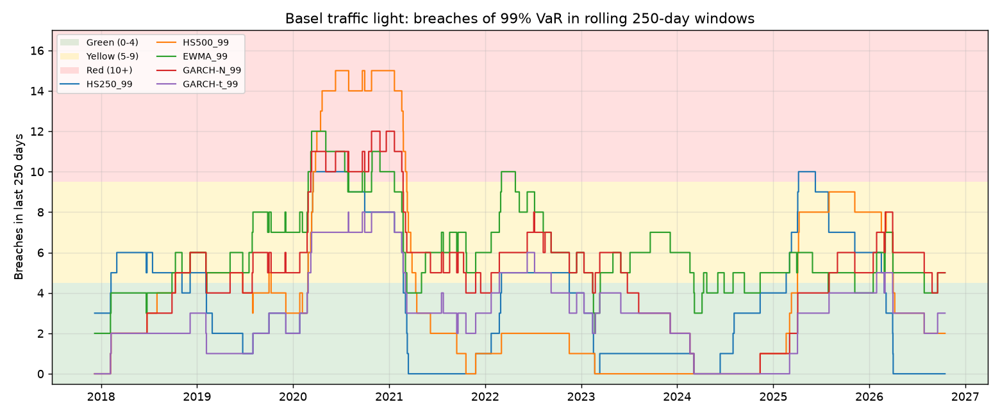

# Value-at-Risk backtesting: five models on a DAX portfolio

Built with Claude Code as a starting point; methodology reviewed and verified by me.

## Question

**Does better volatility forecasting give better risk numbers?**

The project compares 1-day Value-at-Risk (VaR) models on a small European equity portfolio, from
simple historical simulation to GARCH with fat tails. It backtests them the way bank risk-control
teams do: breach counts, Kupiec and Christoffersen tests, and the Basel traffic light.



*Daily portfolio returns against the 99% GARCH-t VaR, with the 29 days the loss exceeded VaR marked in red.*



*How many times each 99% VaR model was breached in the previous 250 days, against the Basel green, yellow and red zones.*

## Data

- **Stocks:** SAP.DE, SIE.DE, ALV.DE, BAS.DE, DTE.DE (Xetra, EUR) from Yahoo Finance via `yfinance`.
- **Prices:** daily closes adjusted for dividends and splits, from 2 Jan 2015 to 16 Oct 2026
  (2,998 trading days). Only completed trading days are used: a snapshot never includes the day it
  was downloaded.
- **Date alignment:** inner join across the five stocks, with no forward-filling. It dropped 0 dates.
- **DAX index (^GDAXI):** stored in the same snapshot. It is only used in the Siemens sensitivity run.
- **Data quality check:** lists single-day stock returns above ±15% for review. It found four, all
  reviewed and kept as genuine market moves:

  | Date | Ticker | Return |
  |---|---|---|
  | 2020-03-12 | ALV.DE | −15.33% |
  | 2020-03-24 | ALV.DE | +15.80% |
  | 2020-10-26 | SAP.DE | −21.94% |
  | 2026-01-29 | SAP.DE | −16.07% |

  The Siemens Energy spin-off day (28 Sep 2020) looks wrong in the Yahoo data. See
  [Limitations](#limitations).

**The raw price data is not in this repository**, because Yahoo's terms do not allow
redistributing it. See [How to run](#how-to-run) to recreate it.

## Method

**Portfolio:** equal weights (20% each), rebalanced daily. The portfolio return is the weighted
sum of the stocks' daily simple returns.

**VaR models:** all are 1-day models at 99% (main) and 95%. VaR is reported as a positive loss in %
of portfolio value.

| Model | Volatility / distribution |
|---|---|
| HS250, HS500 | Historical simulation: empirical quantile of the last 250 or 500 returns |
| EWMA | RiskMetrics: λ = 0.94, zero mean, normal distribution. The starting variance is the mean of squared returns over the first 250 days (burn-in, not evaluated). |
| GARCH-N | GARCH(1,1), zero mean, normal innovations |
| GARCH-t | GARCH(1,1), zero mean, Student-t innovations |

GARCH is estimated with `arch` on percent returns, using a rolling 1,000-day window (expanding from
500 days at the start). It is re-estimated every 20 trading days. Between refits, the variance is
updated daily with fixed parameters.

**No look-ahead:** the forecast for day *t* uses returns up to *t−1* only, including the GARCH
parameter estimates. A breach on day *t* means r_t < −VaR_t. Unit tests check this for every model.

**Common backtest period:** every model is evaluated from **20 Dec 2016 to 16 Oct 2026
(2,497 days)**. That is the first day all models have a forecast: HS500 and GARCH both need 500
days of history. No parameters were tuned on backtest results.

**Backtests:**
- Breach count and breach rate
- Kupiec proportion-of-failures test (χ², 1 df)
- Christoffersen independence test (χ², 1 df) and conditional coverage test (χ², 2 df)
- Basel traffic light for 99%: rolling 250-day breach count, green 0–4, yellow 5–9, red 10+
- Breaches per calendar year
- All tests use 5% significance

**Expected Shortfall** at 97.5% and 99%:
- Historical: average loss beyond VaR in the window
- Closed-form normal: EWMA, GARCH-N
- Closed-form Student-t: GARCH-t
- Checked with a simple ratio: on VaR-breach days, the average realised loss divided by the average
  ES forecast

**Regime split** (descriptive only): a day is "turbulent" if the 60-day rolling portfolio volatility
(up to *t−1*) is above its expanding median (also up to *t−1*). This rule was fixed in advance.

## Results

All numbers below come from `outputs/run_log.txt` and the CSV files in `outputs/`, produced by
`python run_all.py` on the snapshot `prices_2026-10-19.csv`.

### VaR backtest, 99% (25.0 expected breaches)

| Model | Breaches | Rate | Kupiec p | Indep. p | Cond. cov. p | Latest Basel zone (count) | Windows green / yellow / red |
|---|---|---|---|---|---|---|---|
| HS250 | 34 | 1.36% | 0.085 | 0.011 ✗ | 0.009 ✗ | green (0) | 59% / 35% / 6% |
| HS500 | 37 | 1.48% | 0.024 ✗ | 0.002 ✗ | 0.001 ✗ | green (2) | 68% / 21% / 11% |
| EWMA | 57 | 2.28% | 0.000 ✗ | 0.190 | 0.000 ✗ | yellow (5) | 21% / 70% / 9% |
| GARCH-N | 46 | 1.84% | 0.000 ✗ | 0.062 | 0.000 ✗ | yellow (5) | 40% / 49% / 11% |
| GARCH-t | 29 | 1.16% | 0.429 | 0.348 | 0.471 | green (3) | 81% / 19% / 0% |

✗ = rejected at 5%.

### VaR backtest, 95% (124.9 expected breaches)

| Model | Breaches | Rate | Kupiec p | Indep. p | Cond. cov. p |
|---|---|---|---|---|---|
| HS250 | 141 | 5.65% | 0.146 | 0.003 ✗ | 0.004 ✗ |
| HS500 | 121 | 4.85% | 0.722 | 0.000 ✗ | 0.000 ✗ |
| EWMA | 148 | 5.93% | 0.039 ✗ | 0.040 ✗ | 0.014 ✗ |
| GARCH-N | 130 | 5.21% | 0.638 | 0.003 ✗ | 0.012 ✗ |
| GARCH-t | 142 | 5.69% | 0.123 | 0.043 ✗ | 0.039 ✗ |

### Breaches per year (99% models)

| Year | HS250 | HS500 | EWMA | GARCH-N | GARCH-t |
|---|---|---|---|---|---|
| 2017 | 3 | 0 | 2 | 0 | 0 |
| 2018 | 5 | 6 | 6 | 6 | 3 |
| 2019 | 2 | 3 | 7 | 5 | 2 |
| 2020 | 8 | 15 | 10 | 12 | 8 |
| 2021 | 1 | 1 | 6 | 4 | 3 |
| 2022 | 4 | 1 | 6 | 6 | 4 |
| 2023 | 1 | 0 | 6 | 2 | 2 |
| 2024 | 4 | 1 | 5 | 1 | 0 |
| 2025 | 6 | 8 | 4 | 5 | 4 |
| 2026 (to 16 Oct) | 0 | 2 | 5 | 5 | 3 |

The backtest starts on 20 Dec 2016 and there were no breaches in those last days of 2016. The 95%
table is in `outputs/breaches_per_year.csv`.

### Expected Shortfall check (realised loss / ES forecast on breach days)

| Model | 97.5%: breaches, ratio | 99%: breaches, ratio |
|---|---|---|
| HS250 | 78, 1.05 | 34, 1.15 |
| HS500 | 71, 1.03 | 37, 0.93 |
| EWMA | 96, 1.18 | 57, 1.17 |
| GARCH-N | 81, 1.17 | 46, 1.19 |
| GARCH-t | 74, 1.01 | 29, 1.01 |

### Breach rates by regime (descriptive: 1,457 calm days, 1,040 turbulent days)

| Model | 99% calm | 99% turbulent | 95% calm | 95% turbulent |
|---|---|---|---|---|
| HS250 | 1.24% | 1.54% | 5.63% | 5.67% |
| HS500 | 1.03% | 2.12% | 4.12% | 5.87% |
| EWMA | 2.47% | 2.02% | 7.07% | 4.33% |
| GARCH-N | 1.65% | 2.12% | 5.22% | 5.19% |
| GARCH-t | 1.03% | 1.35% | 5.90% | 5.38% |

### GARCH estimation

- 125 refits per variant, with 0 convergence failures.
- α+β ranges from 0.838 to 0.991 for GARCH-N and from 0.815 to 1.000 for GARCH-t.
- The Student-t degrees of freedom ν range from 3.8 to 9.0.
- Charts: `outputs/garch_parameters.png`.

### Answer to the question

The answer is "yes, but only if the tail distribution is right too". At 99%:
- Better volatility forecasts with a **normal** distribution (EWMA, GARCH-N) gave *more* breaches
  than historical simulation: 57 and 46, against 34 and 37.
- Breaches for the volatility models are no longer clustered (independence not rejected), but
  their normal tails are too thin. Realised tail losses were 17–19% larger than their ES forecasts.
- **GARCH with Student-t innovations** combines a responsive volatility forecast with fat tails. It
  is the only model that passes all three tests at 99%. It never entered the red Basel zone, and
  its ES forecasts match realised tail losses (ratio 1.01).
- Historical simulation is roughly right on breach *counts* at 95% but fails the independence test
  at both levels. Its breaches cluster after shocks (HS500: 15 breaches in 2020, 2.12% breach rate
  in turbulent periods against 1.03% in calm periods).
- At 95%, all models fail independence or conditional coverage. For GARCH-t this is borderline
  (p = 0.043) and disappears on the shorter sample of the GARCH burn-in robustness check (see
  Limitations).

### Sanity checks

- No model has suspiciously few breaches. All are within 0.5× to 2× of their expected count, except
  EWMA 99% at 2.28×.
- EWMA 99% was investigated as a possible bug. Its standardised returns r_t/σ_t have a standard
  deviation of 1.06, so the volatility forecast is reasonable. Their 1% quantile is −3.00, against
  −2.33 for a normal distribution (excess kurtosis 3.3). The excess breaches come from the normality
  assumption, not from a coding error.
- GARCH-t's good result is not caused by look-ahead: the unit tests change r_t on both a refit day
  and a non-refit day and confirm that VaR_t does not move. Its breach count is also slightly above
  the expected level, not below.

## Limitations

- **Siemens Energy spin-off (28 Sep 2020):** the Yahoo data shows SIE.DE +9.22% on that day, while
  the DAX rose 3.22% and the other four stocks rose 1.06% to 4.62%.
  - Yahoo has no spin-off record for Siemens, and even its unadjusted close jumps, so the
    adjustment looks inconsistent.
  - The raw value is kept in the main results. A sensitivity run replaced it with the DAX return,
    which lowers that day's portfolio return from 4.30% to 3.10%.
  - In the sensitivity run, only EWMA 99% changes: 58 instead of 57 breaches (one extra breach on
    15 Oct 2020) and red-window share 10.3% instead of 9.1%. No test decision changes, the latest
    Basel zone is unchanged, and all other models are unaffected (`outputs/siemens_sensitivity.csv`).
  - The true Xetra prices were not verified against an independent source.
- **Data source:** Yahoo Finance adjusted prices are convenient, but they are not an audited
  source. Adjustment factors can change between downloads, which is why a dated snapshot is used.
- **Model assumptions:**
  - All parametric models assume a zero mean and a symmetric distribution, so negative skew isn't
    modelled.
  - EWMA and GARCH-N assume normality, which the results reject at 99%.
  - Historical simulation assumes the past window represents tomorrow.
  - The GARCH parameters are re-estimated only every 20 days, and α+β reaches the boundary of
    1.000 in some GARCH-t estimates (late 2017, while the estimation window was still expanding).
- **GARCH burn-in robustness check:** the main specification starts GARCH after 500 days. I re-ran
  both GARCH models with a full 1,000-day first window (`GARCH_ROBUSTNESS_MIN_WINDOW`), which
  moves their backtest to **5 Dec 2018 – 16 Oct 2026 (1,997 days)**.
  - From day 1,000 onward both versions refit on the same dates with the same 1,000-day window,
    so their VaR forecasts are identical on every shared day (largest difference 0.00). The check
    therefore only measures the effect of dropping Dec 2016 – Dec 2018 from the sample.
  - **99%:** no decision changes. GARCH-N has 41 breaches (2.05%) and is still rejected by Kupiec
    and conditional coverage, with latest zone yellow. GARCH-t has 27 breaches (1.35%), still
    passes all three tests, and its latest zone is still green.
  - **95%:** GARCH-N is still rejected on independence and conditional coverage. **GARCH-t's
    rejection disappears**: the independence p-value goes from 0.043 to 0.267 and conditional
    coverage from 0.039 to 0.255, because 5 of its 14 back-to-back breach pairs fell in the dropped
    years. Its 95% independence rejection in the main results was borderline and depends on the
    sample period.
  - Details: `outputs/garch_min_window_check.csv`.
- **Portfolio:** fixed equal weights with daily rebalancing and no transaction costs. With five
  large-cap German stocks, there is little diversification.
- **Statistics:**
  - Ten model × level combinations are each tested at 5%, so some rejections may be chance.
  - The Christoffersen test only detects breaches on consecutive days.
  - The ES check is a plausibility ratio, not a formal test.
  - Regime breach rates rest on few breaches, about 10 expected at 99% in the turbulent sample.
- **Scope:** 1-day horizon only, no 10-day scaling, no stressed VaR, and no formal ES backtests
  (e.g. Acerbi–Székely).

## How to run

```bash
python3 -m venv .venv
source .venv/bin/activate
pip install -r requirements.txt

python run_all.py --refresh   # first run: download data, save data/raw/prices_<today>.csv
python run_all.py             # later runs: reuse the newest snapshot (identical results)
python -m pytest              # 18 unit tests
jupyter notebook notebooks/01_var_backtest.ipynb   # step-by-step walkthrough
```

**Recreating the data:**
- `--refresh` downloads prices up to the last completed trading day and saves them as
  `data/raw/prices_<download date>.csv`.
- Without the flag, the newest snapshot in `data/raw/` is used.
- The results above come from a snapshot downloaded on **19 Oct 2026** (data up to 16 Oct 2026).
- A new download will give a later end date, and Yahoo may have revised past adjustment factors,
  so numbers can differ slightly.
- To reproduce this exact period, set `END_DATE = "2026-10-17"` in `config.py` (the end date is
  exclusive) before running with `--refresh`.

**Project layout:**
- `config.py`: all parameters
- `src/`: `data.py`, `portfolio.py`, `var_models.py`, `backtest.py`, `plots.py`
- `run_all.py`: the command-line pipeline
- `notebooks/`: the walkthrough
- `tests/`: unit tests
- `outputs/`: charts, CSVs and `run_log.txt`
- `LEARNING_NOTES.md`: every modelling decision and known pitfall, with file and function names
